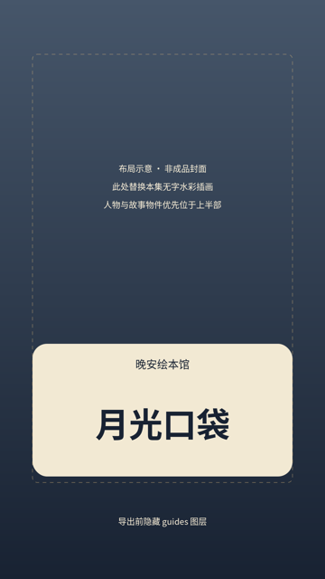

# 统一封面规范

版本：bedtime-cover-v1｜2026-11-09。用户要求统一模板、用简短几个字描述当集内容。以下为可直接执行的版式默认值，首个真实封面尚未审看。

## 固定与可变

每集独立交付1张1080×1920、9:16、sRGB PNG。固定颜色、字体、位置、圆角卡片与系列名；只替换本集背景和短标题。封面不计入九张剧情图，不默认作为片头插入，不延长开场音乐。

- 底图：本集独立插画或本集一张合适原图，保持水彩、细纸纹、灰蓝夜色与暖灯。选图展示本集关键事物，角色遵循角色JSON；首次缺少可用图时记为待制作。
- 生成底图无文字，标题后期排版，不让图像模型生成汉字。
- 标题优先4–6个汉字，允许2–8字，最多两行、每行最多4字；按词义换行。不直接照搬长故事名，不用抽象说教、夸张承诺或制作标签。
- 例：001“晚安星光”；002“月光口袋”；003“云朵枕头”；010“晚安书签”。这是文案建议，不是已完成封面。

## 1080×1920版式

| 元素 | 固定参数 |
| --- | --- |
| 背景 | 全幅铺满，等比裁切；主体与故事物件主要落在x120–900、y180–1080 |
| 色板 | 深夜蓝`#182232`、暖米白`#FFF4DC`、柔金`#D9B77B` |
| 标题卡 | x108/y1140/w864/h440，圆角48，暖米白94%不透明；不遮角色脸或关键道具 |
| 系列名 | “晚安绘本馆”，中心x540，文字顶部y1180，36px，Medium，深夜蓝 |
| 主标题 | 中心x540，首行文字顶部y1260，第二行y1392，112px、Bold，行高132px，深夜蓝；单行时顶部y1320 |
| 字体 | Noto Sans CJK SC；禁止花体、细线字、描边挤满笔画；同批固定字体文件与版本 |
| 安全区 | 文字都在x108–972/y180–1600；中心3:4裁切（y240–1680）仍保留标题。具体平台另测，不承诺所有平台裁切一致 |

模板：[cover-template.svg](templates/cover-template.svg)。SVG中的灰蓝布局底与提示只供排版，不是已完成剧情插画；替换`episode-art`图层、编辑标题、隐藏`guides`再导出PNG。超过8字应精炼文案，不缩小字号强塞。单行/两行采用同一模板，不逐集重做视觉设计。

## 交付与检查

保存`cover.png`、可编辑`cover.svg`、无字底图、标题文本、源图路径/提示词、字体许可与模板版本。封面应在1080px和缩至360px宽时检查：标题易读、字形完整、内容与本集一致、关键物件不被遮挡、安全裁切无缺字。封面本身不要求拼音；逐字拼音是正片字幕要求。

## 版式预览

